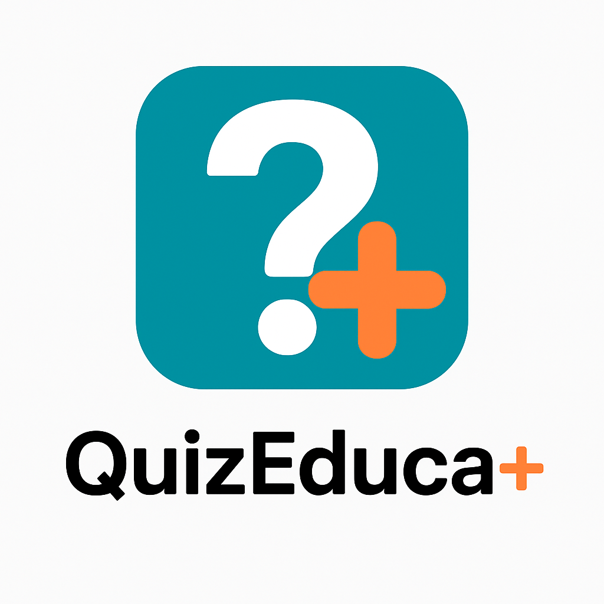

<p align="center">
  
</p>

<h1 align="center">📚 QuizEduca</h1>

<p align="center">
  <em>Aprenda jogando! Um quiz educativo no estilo Wordle com perguntas de diversas disciplinas escolares.</em>
</p>

<p align="center">
  
  
  
  
  
</p>

---

## 🎮 Sobre o Projeto

**QuizEduca** é um aplicativo Android educativo que combina a mecânica do popular jogo **Wordle** com conteúdos do currículo escolar brasileiro. O jogador recebe uma dica (texto-base) sobre um tema e deve adivinhar a palavra-resposta, letra por letra, dentro de um número limitado de tentativas.

A cada tentativa, as letras mudam de cor para indicar se estão:
- 🟩 **Verde** — na posição correta
- 🟧 **Laranja** — presente na palavra, mas em outra posição
- ⬜ **Cinza** — não presente na palavra

---

## ✨ Funcionalidades

| Funcionalidade | Descrição |
|---|---|
| 🎯 **13 Temas** | Perguntas de diversas disciplinas escolares |
| 🎚️ **3 Níveis de Dificuldade** | Fácil (6 tentativas), Médio (3), Difícil (1) |
| 🔄 **Carrossel de Temas** | Navegação visual com ícones e indicadores |
| ⌨️ **Teclado Customizado** | Teclado virtual integrado com feedback de cores |
| 🏆 **Diálogos de Vitória/Derrota** | Feedback visual ao finalizar cada rodada |
| 📖 **Tela "Sobre"** | Informações sobre o aplicativo |
| ❓ **Diálogo de Ajuda** | Instruções de como jogar |
| 🗄️ **Banco de Dados Local** | Centenas de perguntas armazenadas via SQLite |

---

## 📚 Temas Disponíveis

<table>
  <tr>
    <td align="center">🌐 Geral</td>
    <td align="center">📜 História</td>
    <td align="center">🌍 Geografia</td>
    <td align="center">🧬 Biologia</td>
  </tr>
  <tr>
    <td align="center">📐 Matemática</td>
    <td align="center">📝 Português</td>
    <td align="center">🇬🇧 Inglês</td>
    <td align="center">⚛️ Física</td>
  </tr>
  <tr>
    <td align="center">🧪 Química</td>
    <td align="center">🎨 Arte</td>
    <td align="center">🏃 Educação Física</td>
    <td align="center">💭 Filosofia</td>
  </tr>
  <tr>
    <td align="center" colspan="4">🏛️ Sociologia</td>
  </tr>
</table>

---

## 🏗️ Arquitetura do Projeto

```
app/src/main/java/com/quizeduca/app/
├── MainActivity.java       # Tela inicial com carrossel de temas e seleção de dificuldade
├── QuizActivity.java       # Tela principal do jogo (grid de letras + teclado)
├── SobreActivity.java      # Tela "Sobre" com informações do app
├── Pergunta.java           # Modelo de dados para as perguntas (id, tema, texto, resposta)
├── TemaItem.java           # Modelo para itens do carrossel (ícone + nome)
├── TemaAdapter.java        # Adapter RecyclerView para o ViewPager2 do carrossel
├── BitmapUtils.java        # Utilitário para processamento de imagens (trim de bordas)
└── QuizDbHelper.java       # Helper SQLite com criação do banco e centenas de perguntas
```

### Layouts

| Layout | Descrição |
|---|---|
| `activity_main.xml` | Tela inicial com carrossel e botão "Jogar" |
| `activity_quiz.xml` | Tela do quiz com grid de respostas e teclado |
| `activity_sobre.xml` | Tela com informações sobre o aplicativo |
| `dialogo_ajuda.xml` | Dialog com regras e instruções do jogo |
| `dialogo_vitoria.xml` | Dialog exibido ao acertar a palavra |
| `dialogo_derrota.xml` | Dialog exibido ao esgotar as tentativas |
| `item_tema.xml` | Item individual do carrossel de temas |

---

## 🛠️ Tecnologias Utilizadas

- **Linguagem:** Java
- **Plataforma:** Android (Min SDK 24 / Target SDK 36)
- **Build System:** Gradle (Kotlin DSL)
- **Banco de Dados:** SQLite (via `SQLiteOpenHelper`)
- **UI Components:**
  - `ViewPager2` — carrossel de temas
  - `GridLayout` — grade de letras do quiz
  - `Material Design` — botões do teclado (`MaterialButton`)
  - `ConstraintLayout` — layouts responsivos
- **Otimização:** `LruCache` para cache de bitmaps dos ícones

---

## 🎲 Como Jogar

1. **Escolha um tema** deslizando o carrossel na tela inicial
2. **Toque em "Jogar"** e selecione a dificuldade:
   - 🟢 **Fácil** — 6 tentativas
   - 🟡 **Médio** — 3 tentativas
   - 🔴 **Difícil** — 1 tentativa
3. **Leia a dica** (texto-base) exibida no topo da tela
4. **Digite a palavra** usando o teclado virtual
5. **Pressione ENTER** para verificar sua resposta
6. **Analise as cores** das letras e tente novamente!

---

## 🚀 Como Executar

### Pré-requisitos

- [Android Studio](https://developer.android.com/studio) (versão recente)
- JDK 11 ou superior
- SDK Android com API 36 instalada

### Passos

```bash
# 1. Clone o repositório
git clone https://github.com/Santozz06/quizEduca.git

# 2. Abra o projeto no Android Studio
#    File → Open → selecione a pasta do projeto

# 3. Aguarde o Gradle sincronizar as dependências

# 4. Execute o app
#    Clique em Run ▶ ou use Shift + F10
```

> **💡 Dica:** O banco de dados é criado automaticamente na primeira execução com todas as perguntas pré-carregadas.

---

## 📦 Dependências

```kotlin
dependencies {
    implementation(libs.appcompat)
    implementation(libs.material)
    implementation(libs.activity)
    implementation(libs.constraintlayout)
    implementation(libs.viewpager2)
    implementation("androidx.gridlayout:gridlayout:1.0.0")
}
```

---

## 🎨 Paleta de Cores

| Cor | Hex | Uso |
|---|---|---|
| 🔵 Primary | `#3A8C9E` | Cor principal / fundo |
| 🔵 Primary Dark | `#2A6C7E` | Variante escura |
| 🟠 Secondary | `#FF914D` | Cor de destaque |
| 🟠 Secondary Dark | `#E6712D` | Variante escura do destaque |
| 🟢 Verde | `#538D4E` | Letra na posição correta |
| ⚫ Cinza | `#3A3A3C` | Letra inexistente |

---

## 📄 Licença

Este projeto é de código aberto para fins educacionais.

---

